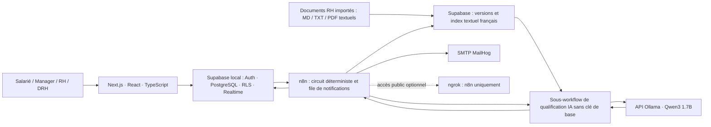

# NovaCorp — Plateforme de demandes RH

Projet fil rouge **M1 DFS · Ingénierie de l'automatisation**. Une demande suit un parcours traçable : formulaire salarié, contrôles SQL, aide à la qualification par Ollama, validation manager → RH → DRH selon les seuils, puis notifications et supervision.

**Environnement livré : développement et démonstration locale, sur données fictives.** Le déploiement VPS sera documenté après validation de sa procédure. Cette documentation distingue les fonctions implémentées des preuves de recette et des éléments de soutenance encore à préparer.

## Sommaire

- [Fonctionnalités et périmètre](#fonctionnalites)
- [Architecture et choix techniques](#architecture)
- [Prérequis](#prerequis)
- [Première installation](#installation)
- [Démarrer et arrêter le projet](#demarrage)
- [Adresses des services](#services)
- [Comptes et données fictives](#comptes)
- [Règles métier](#regles)
- [Qualification IA et validation humaine](#ia)
- [Démonstration S1–S5](#demonstration)
- [Tests et preuves](#tests)
- [Configuration, secrets et données](#securite)
- [Exploitation locale et dépannage](#exploitation)
- [Préparation du rendu](#rendu)
- [Structure et documentation](#documentation)

<a id="fonctionnalites"></a>
## Fonctionnalités et périmètre

| Fonction | Comportement |
| --- | --- |
| Demandes RH | Congés, télétravail, matériel et formation ; brouillon, modification, soumission, suivi et annulation |
| RAG documentaire | Import MD/TXT/PDF textuel, recherche française dans les versions actives, synthèse avec citations et extraits visibles au validateur |
| Navigation et listes | Menu adapté au rôle, page active, filtres immédiats de vue/type/statut et pagination de 5 demandes ; affichage mobile |
| S1 — Notification manager | Qualification de la demande, activation du manager assigné et email dans MailHog |
| S2 — Approbation multi-niveaux | Manager puis RH ; DRH au-delà d'un seuil ; décisions et changements de statut historisés |
| S3 — Rappel automatique | Chaque matin à 8 h Paris, rappel au manager après **strictement plus de 48 h** d'attente ; une notification par étape et par jour |
| Alertes RH | Échéance de 48 h pour chaque étape, contrôlée chaque minute ; une alerte par étape |
| S4 — Digest hebdomadaire | Chaque lundi à 8 h Paris : reçues et finalement approuvées la semaine précédente, plus les attentes du manager |
| S5 — Onboarding | Nouveau profil : bienvenue personnalisée et checklist de six étapes du premier jour, sans renvoi lors d'une mise à jour |
| Supervision RH/DRH | Volumes, statuts, délais moyen/médian, validations en retard et incidents ; filtres immédiats et trois listes paginées indépendantes ; actualisation Realtime et rafraîchissement de secours |

Les pièces jointes privées des demandes sont modélisées et protégées en base/Storage ; leur dépôt et leur analyse ne sont pas exposés dans le front. Le [RAG documentaire](docs/rag.md) porte sur des documents RH importés par l'administrateur, avec un corpus initial de démonstration. Pas de chatbot, export PDF/Excel ou emails Slack. MailHog reçoit les emails de démonstration ; la récupération de mot de passe et les emails Supabase Auth ne sont pas configurés.

<a id="architecture"></a>
## Architecture et choix techniques



- **Next.js 16.4.3** : formulaires et interface par rôle en code, validation serveur et session Supabase. Version fixée dans le lockfile, rappels de sécurité activés.
- **Supabase local** : comptes, données, RLS et règles transactionnelles proches des données. Le front utilise la clé publique et la session, sans clé d'administration.
- **n8n 2.42.5** : orchestration visible, planifications, files d'emails, reprises et traces. Les contraintes critiques restent en SQL.
- **Ollama 0.40.1 / Qwen3 1.7B** : modèle local via API, adapté à la démonstration sur CPU. Pas de facture API cloud ; les ressources de la machine ont néanmoins un coût.
- **MailHog** : contrôle des emails sans envoi à de vraies adresses. **ngrok** : accès HTTPS optionnel à n8n ; ce tunnel ne constitue pas un déploiement hors du PC.

Les comptes, mots de passe et emails d'exemple ci-dessous sont uniquement fictifs. Les choix Q1–Q5, le budget et le plan ×100 doivent être développés dans le dossier final, pas déduits de la seule liste de technologies.

<a id="prerequis"></a>
## Prérequis

- Windows/PowerShell ou environnement compatible ; **Node.js 22.19+** et npm ; dépendances installées avec `npm ci`.
- Docker Desktop démarré en mode conteneurs Linux ; Git.
- Ports libres : 3000, 1025, 8025, 5678, 11434, 54320–54324 ; 4040 pour ngrok si utilisé.
- Connexion Internet au premier téléchargement des dépendances, images et poids du modèle. Le modèle représente environ 1,4 Go, en plus des images/volumes.
- Supabase CLI **2.120.0** est fixée dans le projet : aucun compte Supabase cloud requis.

<a id="installation"></a>
## Première installation

Depuis la racine du dépôt, avec Docker Desktop ouvert :

```powershell
npm ci
npm run mail:start
npm run supabase:start
npm run local:env
npm run db:migrate
npm run auth:seed
npm run business:seed
npm run rag:seed
npm run llm:start
npm run llm:pull
npm run n8n:start
npm run n8n:setup
npm run n8n:verify
npm run n8n:qualification:install
npm run n8n:qualification:start
npm run n8n:approvals:install
npm run n8n:approvals:start
npm run n8n:reminders:install
npm run n8n:reminders:start
npm run n8n:digest:install
npm run n8n:digest:start
npm run n8n:onboarding:install
npm run n8n:onboarding:start
npm run dev
```

MailHog crée le réseau `novacorp_default`, partagé avec Supabase. `local:env` génère `.env.local` sans afficher les clés. `n8n:start` prépare sa configuration locale ; `n8n:setup` importe les connexions Supabase/MailHog chiffrées et le workflow de vérification. Créer le propriétaire n8n au premier accès : ce compte est indépendant des comptes RH.

L'import d'un workflow ne le publie pas. La qualification utilise un sous-workflow IA nommé `novacorpAiQualification`, importé avec elle ; ne pas l'effacer. Après un changement des générateurs/prompts, relancer l'installation puis l'activation correspondantes. L'ancien `novacorpManagerEmails` est remplacé par `novacorpNotifications` : ne pas le republier avec le circuit complet.

<a id="demarrage"></a>
## Démarrer et arrêter le projet

### Reprise d'une installation existante

```powershell
npm run mail:start
npm run supabase:start
npm run db:migrate
npm run llm:start
npm run n8n:start
npm run dev
```

Les volumes conservés contiennent les comptes, données, modèle et publications. Ne pas rejouer les initialisations pour simplement reprendre une démonstration.

### Démarrer les services du Compose

```powershell
docker compose --profile automation up -d
```

Cette commande concerne **MailHog, n8n et Ollama**. Supabase est lancé par sa CLI et le front par `npm run dev` : ils ne sont pas inclus dans ce Compose.

### Accès public optionnel à n8n

```powershell
npm run ngrok:env
# Renseigner le token uniquement dans .env.ngrok.local
npm run ngrok:start
```

Exécuter `ngrok:start` après les commandes qui réappliquent la configuration locale de n8n. Supabase reste local. Le webhook du TP transmet uniquement l'identifiant, le statut et le type d'événement après autorisation de sa destination ; il ne lance pas le traitement métier. Lire [la procédure ngrok](docs/ngrok-webhook.md) avant de le connecter.

En mode public, utiliser l'URL HTTPS affichée par `ngrok:start` pour ouvrir l'éditeur n8n.

### Arrêt sans suppression des données

Arrêter le front avec `Ctrl+C`, puis :

```powershell
npm run ngrok:stop  # si le tunnel est actif
npm run n8n:stop
npm run llm:stop
npm run supabase:stop
npm run mail:stop
```

Ne pas supprimer les volumes pour arrêter le projet. **`supabase db reset` efface les données locales**. MailHog stocke ses messages en mémoire : leur contenu disparaît à son redémarrage.

<a id="services"></a>
## Adresses des services

| Service | Adresse locale |
| --- | --- |
| Application | <http://localhost:3000/connexion> |
| n8n | <http://localhost:5678> |
| MailHog | <http://localhost:8025> |
| Supabase API | <http://127.0.0.1:54321> |
| Supabase Studio | <http://127.0.0.1:54323> |
| Ollama | <http://127.0.0.1:11434> |
| SMTP depuis Docker | `mailhog:1025` |

<a id="comptes"></a>
## Comptes et données fictives

Mot de passe **initial** commun : `NovaCorpDemo2026!`. Les scripts ne réinitialisent pas un mot de passe déjà modifié.

| Compte | Rôle / relation |
| --- | --- |
| `salarie@novacorp.test` | Camille Durand, salarié rattaché à Alex |
| `manager@novacorp.test` | Alex Martin, manager de Camille ; Sofia valide ses demandes personnelles |
| `manager2@novacorp.test` | Sofia Moreau, manager d'Alex ; sans manager supérieur dans ce jeu |
| `rh@novacorp.test` | Morgan Petit, RH |
| `drh@novacorp.test` | Lou Bernard, DRH |
| `demo.salarie@novacorp.test` | Emma Laurent, jeu de démonstration optionnel |

Pour préparer les 23 demandes d'Emma :

```powershell
npm run demo:seed
```

Le jeu est idempotent et conserve les demandes existantes. Il contient des historiques **simulés**, pas des preuves d'exécutions réelles du modèle. Certaines anciennes fixtures portent encore des intitulés de relance à 24 h ; la règle S3 active est bien le rappel quotidien après plus de 48 h. Voir [les données de démonstration](docs/demo-data.md).

L'inscription publique est désactivée. Les comptes sont créés via l'administration. Sofia ne peut pas soumettre de demande personnelle tant qu'aucun manager ne lui est affecté ; ce comportement protège contre l'auto-validation.

<a id="regles"></a>
## Règles métier

| Type | Circuit | Seuil de validation DRH |
| --- | --- | --- |
| Congés | Manager → RH → DRH si seuil dépassé | Strictement plus de 10 jours ouvrés |
| Télétravail | Manager → RH | Pas de DRH |
| Matériel | Manager → RH → DRH si seuil dépassé | Strictement plus de 1 000 EUR |
| Formation | Manager → RH → DRH si seuil dépassé | Strictement plus de 1 500 EUR |

Les règles et validateurs sont figés à la soumission. Le salarié ne modifie plus une demande soumise. Les congés sont réservés à la soumission, consommés à l'acceptation, libérés au refus/à l'annulation. Les dates, soldes, conflits, doublons et décisions sont contrôlés en base, sous RLS. Une échéance ne vaut jamais accord automatique. Voir [les règles détaillées](docs/business-rules.md).

Chaque étape dispose de 48 h calendaires à partir de son activation. S3 prépare les rappels à 8 h Paris ; S4 prépare les digests le lundi à 8 h Paris. **L'heure prévue est celle de mise en file**, la réception dépend de la file SMTP et du fonctionnement de Docker/n8n. Les changements d'heure sont pris en compte. Les semaines manquées ne sont pas reconstituées automatiquement.

<a id="ia"></a>
## Qualification IA et validation humaine

Le parent n8n réserve la demande et obtient ses contrôles SQL. Après minimisation des données, il recherche trois extraits dans les documents RH actifs du type concerné. Il conserve leurs versions et leur contenu dans un instantané avant d'appeler le sous-workflow. Ce dernier n'a aucun identifiant Supabase, aucun outil d'écriture et aucune URL choisie par le modèle. Il appelle uniquement Ollama, puis valide une sortie JSON fermée : qualification, synthèse, brouillon de réponse et citations. Les extraits sont visibles sur la fiche du validateur.

Les faits SQL priment sur la proposition du modèle. Les emails/UUID/téléphones reconnaissables sont masqués dans le texte ; cela ne garantit pas l'anonymisation de tout texte libre. Le modèle peut se tromper. Manager, RH et DRH prennent les décisions métier ; les écritures automatiques concernent les traces et la préparation du circuit. Le brouillon IA n'est pas envoyé automatiquement au salarié.

Prompt actif : **`hr-qualification-v3-rag`**, estampillé lors de la recherche documentaire effective. Les prompts, le schéma, la politique et les descriptions des RPC autorisées sont versionnés. Consulter [le contrat IA et les tests N1–N5](docs/ai-governance.md). Les N1–N5 sont propres au projet et ne sont pas présentés comme les T1–T5 officiels du cours, dont la définition doit encore être rapprochée.

Le RAG utilise une recherche textuelle française PostgreSQL, sans embeddings ni modèle supplémentaire. Le premier corpus reprend les règles de démonstration NovaCorp. Pour ajouter tes propres documents MD/TXT/PDF textuels :

```powershell
npm run rag:import -- --file "rag/inbox/politique-conges.pdf" --slug politique-conges --title "Politique des congés" --version 1 --types leave
npm run rag:verify
```

L'import devient disponible pour les nouvelles qualifications. Une mise à jour conserve le slug et augmente `--version`. Les scans nécessitent un OCR préalable. Voir [formats, commandes, permissions et limites](docs/rag.md). Une absence de sources/citations impose une vérification humaine ; une citation inconnue est rejetée. Un document ne modifie jamais les règles SQL.

<a id="demonstration"></a>
## Démonstration S1–S5

Le [guide de démonstration](docs/demo-scenarios.md) précise les comptes, données, actions, résultats attendus et preuves pour chaque scénario, ainsi que les simulations utilisées pour les horodatages.

```powershell
npm run demo:verify -- S1
npm run demo:verify -- S2
npm run demo:verify -- S3
npm run demo:verify -- S4
npm run demo:verify -- S5
npm run demo:verify -- IA
# Toute la recette locale
npm run demo:verify
```

Le lanceur suspend temporairement le service n8n et utilise un conteneur de test sans serveur/planificateur, sur son volume existant. Les copies de workflow ont des identifiants aléatoires ; les comptes/demandes de test sont dédiés et nettoyés. Les publications restent inchangées. Le service initial est redémarré en fin de test avec sa configuration existante, y compris ngrok. Ne pas interrompre brutalement une recette et ne pas en lancer deux simultanément. L'accès public n8n est indisponible pendant les essais isolés. `IA` seul appelle Ollama sans suspendre n8n.

Rapport : `test-results/demo-report.json` (ignoré par Git). N'annoncer comme réussis que les scénarios réellement exécutés avec `passed: true` et une reprise confirmée par `restored: true`. Les vérifications restent **locales et fictives**, pas des tests à lancer sur la future production.

<a id="tests"></a>
## Tests et preuves

| Commande | Vérification |
| --- | --- |
| `npm run ai:test` | Contrat, périmètre, confidentialité, sorties invalides et politique déterministe ; inspection du sous-workflow |
| `npm run demo:verify -- IA` | Trois cas négatifs avec le vrai modèle local |
| `npm run db:verify` | Reconstruction des migrations, tests SQL transactionnels et courses concurrentes dans une base temporaire |
| `npm run db:test` | Tests SQL sur la base locale, fixtures annulées à la fin |
| `npm run db:lint` | Validation des fonctions SQL |
| `npm run lint` / `npm run typecheck` | ESLint / TypeScript |
| `npm run build` | Compilation de production du front |
| `npm test` | Playwright : Auth, RLS, quatre formulaires, décisions manager et supervision RH |

Pour Playwright, installer le navigateur avec `npx playwright install chromium`. Suspendre n8n pendant les tests pour que ses planificateurs ne traitent pas les fixtures de l'interface :

```powershell
docker compose --profile automation stop n8n
npm test
docker compose --profile automation start n8n
```

Les scripts `n8n:*:verify` restent disponibles pour isoler un composant ; ils exigent des planificateurs dépubliés ou l'environnement isolé du lanceur. S2 utilise le vrai LLM via `demo:verify` ; le script historique seul utilise une qualification SQL de fixture. Les décisions du test automatique sont simulées sous les permissions des validateurs, tandis que Playwright et la démo manuelle utilisent les boutons de l'application.

Les captures et rapports de tests sont dans `test-results/`. Conserver des preuves datées pour la soutenance, sans secrets et sans présenter les fixtures simulées comme des mesures réelles.

<a id="securite"></a>
## Configuration, secrets et données

| Fichier / stockage | Rôle |
| --- | --- |
| `.env.local` | URL Supabase, clé publique et clé backend pour les scripts locaux ; généré par `local:env`, ignoré par Git |
| `.env.n8n.local` | Clés backend/chiffrement n8n ; conserver avec le volume, ne pas afficher |
| `.env.ngrok.local` | Token ngrok et URL autorisée ; ignoré par Git |
| Identifiants chiffrés n8n | Connexions Supabase et SMTP ; exports JSON sans secrets |
| Supabase Vault | URL et secret du webhook optionnel |

Ne jamais publier les fichiers `.env`, exporter des identifiants en clair ou copier des clés dans des captures. Ne pas afficher un `docker compose config` contenant les valeurs résolues. `.env.example` décrit uniquement les variables nécessaires au front et aux scripts, sans secrets réels.

Les pages privées vérifient la session ; la RLS isole les profils, demandes, fichiers et revues selon les rôles. Les RPC backend restent réservées à `service_role`. Les salariés n'éditent pas leur rôle/manager et les brouillons restent privés. Les données utilisées pour le TP doivent être fictives. La **durée de conservation et la procédure de purge restent à définir** dans le dossier final ; aucune purge automatique des demandes n'est annoncée.

<a id="exploitation"></a>
## Exploitation locale et dépannage

| Situation | Contrôle / action |
| --- | --- |
| Connexion indisponible | Démarrer Supabase ; vérifier `.env.local` avec `local:env`, puis redémarrer le front si les clés ont changé |
| Demande en analyse | Vérifier Ollama, modèle chargé, exécution de qualification et `workflow_runs` ; reprise limitée à trois tentatives |
| Aucun email | Vérifier MailHog, publication du workflow d'envoi et file correspondante ; cinq tentatives SMTP maximum |
| Manager sans demandes d'équipe | Utiliser « Mon équipe » et vérifier le manager figé à la soumission ; Alex et Sofia ont des périmètres distincts |
| Soumission refusée pour manager absent | Affecter un supérieur valide ; aucune auto-validation de manager |
| Tunnel ne répond plus | Relancer `ngrok:start` après la reprise locale de n8n ; ne pas changer la destination autorisée sans la valider |
| Rappel/digest absent | Vérifier jour, heure Paris, durée d'attente, publication et file ; ne pas changer le cron pour simuler un test |
| Tests interrompus | Vérifier que le conteneur n8n principal est redémarré et qu'aucun conteneur `novacorp-verify-*` dédié n'utilise encore son volume |

```powershell
npm run n8n:logs
docker compose --profile automation ps
npm run supabase:status
```

La supervision affiche les incidents des demandes ; les erreurs d'onboarding/digest sont consultables dans leurs files et exécutions n8n. Les alertes RH de délai sont implémentées ; une alerte technique globale, les sauvegardes et l'exploitation VPS seront traitées dans la phase production. SMTP ne garantit pas exactement une livraison : une interruption après réception mais avant acquittement peut provoquer un nouvel envoi.

<a id="rendu"></a>
## Préparation du rendu

| Attente | État / preuve à préparer |
| --- | --- |
| Fonctionnel | Scénarios S1–S5 et guide rejouable ; montrer un cycle complet réel, un refus et un rejeu sans doublon |
| Architecture | Schéma global ci-dessus, schéma de données et documents de circuit ; compléter la justification Q1–Q5 et le tableau 5S du cours |
| Pilotage IA | Sous-workflow contraint, prompt versionné, matrice N1–N5 ; rapprocher les T1–T5 officiels et conserver les preuves |
| Production | Déploiement VPS, alertes techniques, sauvegardes et procédures à définir après les instructions de déploiement |
| Mesures et coûts | Relever les délais avant/après sur un échantillon explicite, chiffrer infrastructure/LLM et scénario ×100 ; ne pas utiliser les historiques simulés comme observations |
| Soutenance | Préparer ensuite le dossier final, la présentation de 10 minutes et une vidéo/captures de secours ; répéter la répartition de parole |

Les améliorations bonus présentées doivent disposer d'une fiche : intérêt utilisateur, effort de développement, coût d'exploitation et critère de décision. Aucune note n'est déduite du seul nombre de tests ; chaque ligne de la grille doit avoir une preuve montrable.

<a id="documentation"></a>
## Structure et documentation

```text
src/                         Front, Auth, formulaires et supervision
supabase/migrations/         Schéma, RLS et fonctions transactionnelles
supabase/tests/database/     Tests SQL
n8n/lib/                     Prompt, schéma et politique IA
n8n/workflows/               Exports générés sans secrets
scripts/                     Installation, recettes et données fictives
tests/                       Tests unitaires IA et tests Playwright
docs/                        Contrats, procédures et démonstration
compose.yaml                 n8n, Ollama et MailHog locaux
compose.ngrok.yaml           Tunnel optionnel vers n8n
```

| Document | Contenu |
| --- | --- |
| [Scénarios de démonstration](docs/demo-scenarios.md) | Préparation, résultats attendus, simulations et preuves |
| [Pilotage de l'IA](docs/ai-governance.md) | Contrat, limites, RPC, prompts et matrice négative |
| [Schéma de données](docs/database-schema.md) | Relations, champs et permissions |
| [Règles métier](docs/business-rules.md) | Seuils, soldes et circuits |
| [Installation n8n](docs/n8n-local.md) | Connexions, sécurité et cycle de vie |
| [Qualification](docs/n8n-qualification.md) | Parcours Ollama et traces |
| [Approbations](docs/n8n-approvals.md) | Décisions et notifications |
| [Relances](docs/n8n-reminders.md) | Rappels manager et alertes RH |
| [Digest](docs/n8n-weekly-digest.md) | Semaine de référence et file SMTP |
| [Onboarding](docs/n8n-onboarding.md) | Bienvenue et checklist |
| [Supervision](docs/hr-dashboard.md) | Compteurs et incidents |
| [RAG documentaire](docs/rag.md) | Importer des documents, versionner et expliquer les citations |
| [Interface](docs/hr-interface.md) | Formulaires, vues et actions |
| [Données fictives](docs/demo-data.md) | Jeu d'Emma et historiques simulés |
| [Ngrok / webhook](docs/ngrok-webhook.md) | Destination autorisée, payload minimal et Vault |

Références : [Supabase local](https://supabase.com/docs/guides/local-development), [n8n sous-workflows](https://docs.n8n.io/integrations/builtin/core-nodes/n8n-nodes-base.executeworkflow/), [Ollama](https://docs.ollama.com/), [Next.js](https://nextjs.org/docs).
