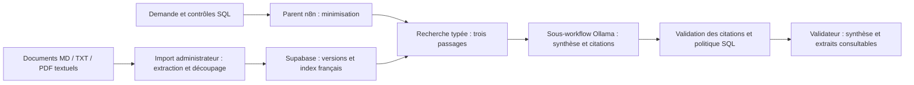

# RAG documentaire RH

## Fonctionnement livré

Le parent n8n réserve une demande et minimise ses données, puis recherche jusqu'à **trois extraits** dans les documents actifs du type concerné. PostgreSQL utilise son index de recherche textuelle française et `ts_rank_cd` : c'est un **RAG lexical**, sans embeddings ni base vectorielle. Aucun second modèle ou conteneur n'est nécessaire. Les mots du type de demande complètent la recherche ; le texte de la demande affine le classement. Le score n'est pas une probabilité de justesse.

Le sous-workflow IA reçoit les faits SQL et les extraits, sans clé de base, identifiant de salarié ou jeton de réservation. Il produit sa synthèse et les identifiants des passages utilisés. La validation rejette les références inconnues ; SQL les vérifie à nouveau avant l'enregistrement. L'absence de documents ou de citations impose `needs_review` si la proposition était `eligible`. Une panne de recherche interrompt la qualification et suit les reprises existantes ; elle ne déclenche pas une qualification silencieuse sans RAG.



Les instantanés sont conservés dans `hr_knowledge_retrievals` et dans `ai_reviews.rag_context` ; aucune requête de recherche n'y est enregistrée. La fiche présente les documents, versions, sections/pages et textes exacts transmis. Un extrait « consulté, non cité » a été transmis mais pas cité par le modèle. Une nouvelle version documentaire ne réécrit pas les anciennes preuves. Les contrôles SQL et le circuit figés à la soumission restent prioritaires : importer un texte ne modifie jamais un seuil métier.

## Premier corpus

```powershell
npm run db:migrate
npm run rag:seed
npm run n8n:qualification:install
npm run n8n:qualification:start
```

Les cinq documents de `rag/corpus/manifest.json` reprennent les règles déjà validées de `docs/business-rules.md` : circuit, congés, télétravail, matériel et formation. Ils sont explicitement **des documents de démonstration**, sans convention collective ou droit légal supposé. Les importer ne crée aucun droit nouveau. Une réimportation identique est sans doublon.

## Ajouter ton propre document

Dépose les documents locaux dans `rag/inbox/` (dossier ignoré par Git), ou indique leur chemin local. Vérifie leur contenu et retire les informations personnelles inutiles avant import. L'import est un acte d'administration : les employés et le LLM ne peuvent pas publier des documents.

```powershell
npm run rag:import -- --file "rag/inbox/politique-conges.pdf" --slug politique-conges --title "Politique des congés" --version 1 --types leave
```

Le fichier devient immédiatement disponible pour les recherches des **nouvelles qualifications** ; aucun redémarrage ou changement de prompt n'est nécessaire. Les demandes déjà qualifiées restent inchangées. Les imports sont actuellement réalisés en CLI, pas depuis une page d'administration.

| Argument | Utilisation |
| --- | --- |
| `--file` | Fichier `.md`, `.txt` UTF-8 ou `.pdf` contenant du texte, 10 Mo maximum |
| `--slug` | Identifiant stable en minuscules/chiffres/tirets, par exemple `politique-conges` |
| `--title` | Titre affiché au validateur |
| `--version` | Version explicite, par exemple `1`, puis `2` pour une modification |
| `--types` | `leave`, `remote_work`, `equipment`, `training`, liste avec virgules, ou `all` |

Pour une version modifiée, garder le slug et augmenter la version :

```powershell
npm run rag:import -- --file "rag/inbox/politique-conges.pdf" --slug politique-conges --title "Politique des congés" --version 2 --types leave
```

L'opération désactive l'ancienne version du même slug et active la nouvelle, dans une transaction. Une version existante est immuable : un changement de fichier, de titre, de portée ou de découpage exige une nouvelle version. Réimporter explicitement une ancienne version identique la réactive ; vérifier la version choisie. Les autres documents restent actifs, y compris les documents de démonstration : en cas de contradiction, l'IA doit signaler une revue humaine. Le projet ne possède pas de moteur de résolution juridique entre documents.

Les PDF scannés, protégés ou sans texte exploitable sont refusés ; effectuer un OCR en amont pour les scans. Les PDF conservent la page, les Markdown la section. Les passages sont bornés à 900 caractères, avec chevauchement pour les longs paragraphes. Le texte extrait et ses métadonnées sont stockés ; le fichier original doit être conservé et sauvegardé par l'administrateur. Les scripts sont volontairement limités à Supabase local ; le futur déploiement nécessitera une procédure d'administration adaptée.

## Permissions et limites

- Tables du corpus et RPC d'import/recherche/réservation réservées à `service_role`, avec RLS activée et droits clients retirés.
- Les validateurs consultent uniquement l'instantané des sources d'une revue qu'ils peuvent déjà lire avec la RLS existante. Ne pas importer de documents dont ces personnes ne devraient pas voir des extraits.
- Le texte d'un document reste non fiable : le prompt interdit ses injonctions, aucun outil n'est exposé au modèle et une référence connue ne prouve pas qu'une phrase générée soit fidèle à la source.
- La recherche lexicale ne comprend pas tous les synonymes ni les images/tableaux complexes ; un document pertinent peut être manqué. Une recherche sémantique avec embeddings pourra être ajoutée si les mesures le justifient.
- L'absence de sources pertinentes donne une vérification humaine, sans décision finale automatique. Une référence générique du bon type peut être retrouvée même si elle ne répond pas à une question précise : le validateur doit vérifier la pertinence des extraits.
- Le modèle et la recherche restent locaux. Les versions et instantanés augmentent le volume PostgreSQL ; leur durée de conservation reste à définir avec celle des traces RH.

## Vérifications et preuve pour la soutenance

```powershell
npm run rag:test
npm run db:test
npm run rag:verify
npm run demo:verify -- S1
```

`rag:verify` importe un document fictif temporaire contenant un code inédit, le retrouve dans Supabase, puis vérifie que le vrai Ollama restitue ce code et cite ce document. Il supprime uniquement son propre document de test. S1 utilise les vrais parent et sous-workflow n8n sur les quatre types ; la recette restaure le service et sa configuration ngrok.

Pour montrer le RAG : importer un document, soumettre une **nouvelle** demande de son type, ouvrir une exécution de qualification ayant réservé une demande, puis consulter « Sources documentaires » avec le compte du validateur. Distinguer cette preuve d'une exécution inactive sur `claimed:false`. Les revues historiques sans RAG restent affichées sans sources.

Prompt courant : `hr-qualification-v3-rag`. La réservation initialise encore une revue v2 pour compatibilité ; la recherche effective avec un jeton valide la marque v3-RAG. Le parent livré effectue systématiquement cette recherche avant l'appel IA. Les fixtures techniques héritées sans recherche ne constituent pas des preuves RAG.

Références techniques : [recherche textuelle PostgreSQL](https://www.postgresql.org/docs/current/textsearch-controls.html), [parseur PDF](https://github.com/mehmet-kozan/pdf-parse).
